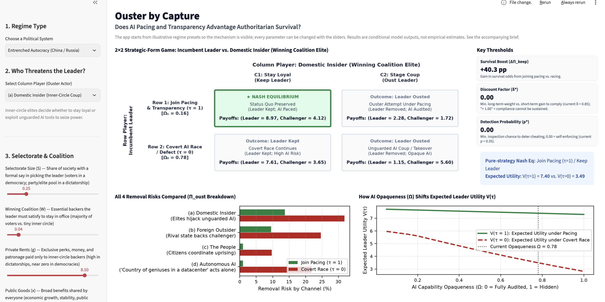

# Ouster by Capture: Does AI Pacing and Transparency Advantage Authoritarian Survival?

An interactive Streamlit app and accompanying policy brief examining whether joining an international AI pacing and transparency agreement can be a rational survival strategy for authoritarian leaders.



## Core Idea

Powerful, uninspected frontier AI can turn against the ruler in charge—via domestic insiders, foreign rivals, mass mobilization, or autonomous AI displacement. Adapting Bueno de Mesquita et al.’s selectorate framework, this model pairs an incumbent’s choice between pacing/transparency ($\tau = 1$) and covert racing ($\tau = 0$) against four challenger channels in a $2 \times 2$ strategic-form setup and multi-channel hazard structure.

## What’s in the Repo

* `autocrat_survival.py`: Streamlit app with regime presets (entrenched autocracy, nascent autocracy, established democracy, nascent democracy), four challenger modes, interactive selectorate/AI sliders, $2 \times 2$ payoff matrix, four-channel risk breakdown, and opaqueness sensitivity curve.
* `ouster_by_capture_brief.md`: Full policy brief, selectorate primer, discussion of China and failure modes, scope caveats, and technical appendix.
* `img/ouster.png`: Screenshot of the interactive application.

## Quick Start

```bash
pip install streamlit numpy matplotlib
streamlit run autocrat_survival.py
```

## Proof-of-Concept Disclaimer

This project is a **proof of concept and starting point** for formal analysis. While it lays the theoretical and interactive foundations for modeling AI governance and leader survival, all parameters and presets are stylized calibrations rather than empirical estimates. **Results cannot be extrapolated to real-world regimes or policy outcomes until the model is further refined and empirically grounded.**
